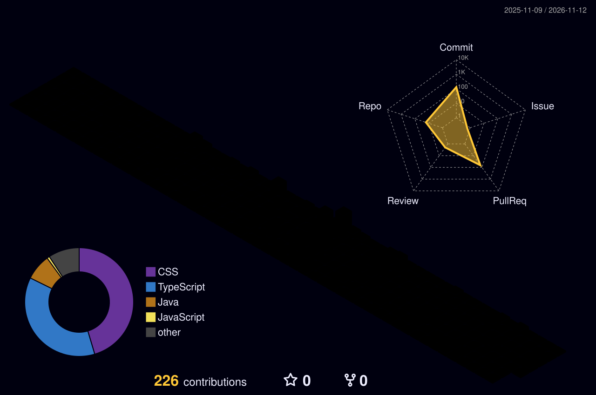

<!-- ========================= HEADER ========================= -->
<div align="center">


<a href="https://github.com/ashishraj1504">
  
</a>

<br/><br/>

<a href="https://linkedin.com/in/ashishraj3108"></a>
<a href="https://discord.gg/ashishraj99"></a>
<a href="mailto:ashishraj6426@gmail.com"></a>


</div>

<!-- ========================= ABOUT ========================= -->
<br/>


```js
const ashish = {
  username: "ashishraj1504",
  role: "Full Stack Developer in the making",
  currentlyWorkingOn: ["Java DSA", "Full Stack Web Dev", "Open Source"],
  currentlyLearning: ["JavaScript", "React", "Next.js", "Node.js"],
  lookingForHelpWith: ["Advanced Backend", "System Design", "GSoC Prep"],
  openToCollaborateOn: ["Web Projects", "Open Source", "Innovative Ideas"],
  askMeAbout: ["Java", "JavaScript", "DSA", "Git", "GitHub"],
  funFact: "I love interactive UI effects, open source & manga 📖",
};
```

<!-- ========================= TECH ========================= -->


<div align="center">


</div>

<!-- ========================= PROJECTS ========================= -->


<!-- Replace repo names & descriptions. Pinned-repo cards update automatically. -->
<div align="center">

<a href="https://github.com/ashishraj1504/HotelManagementSystem"></a>
<a href="https://github.com/ashishraj1504/REPO-2"></a>

<a href="https://github.com/ashishraj1504/REPO-3"></a>
<a href="https://github.com/ashishraj1504/REPO-4"></a>

</div>

<!-- ========================= STATS ========================= -->


<div align="center">


### 🧊 3D Contribution Graph


</div>

<!-- ========================= SNAKE ========================= -->
<div align="center">

### 🐍 Contribution Snake
<picture>
  <source media="(prefers-color-scheme: dark)" srcset="https://raw.githubusercontent.com/ashishraj1504/ashishraj1504/output/github-snake-dark.svg" />
  
</picture>

</div>

<!-- ========================= GOALS ========================= -->


- [ ] Solve 300+ DSA problems in Java
- [ ] Ship & deploy a full-stack Next.js + Node.js project
- [ ] Prepare a strong GSoC proposal

<!-- ========================= FOOTER ========================= -->
<div align="center">

### ✍️ Dev Quote of the Moment


<br/>


</div>
